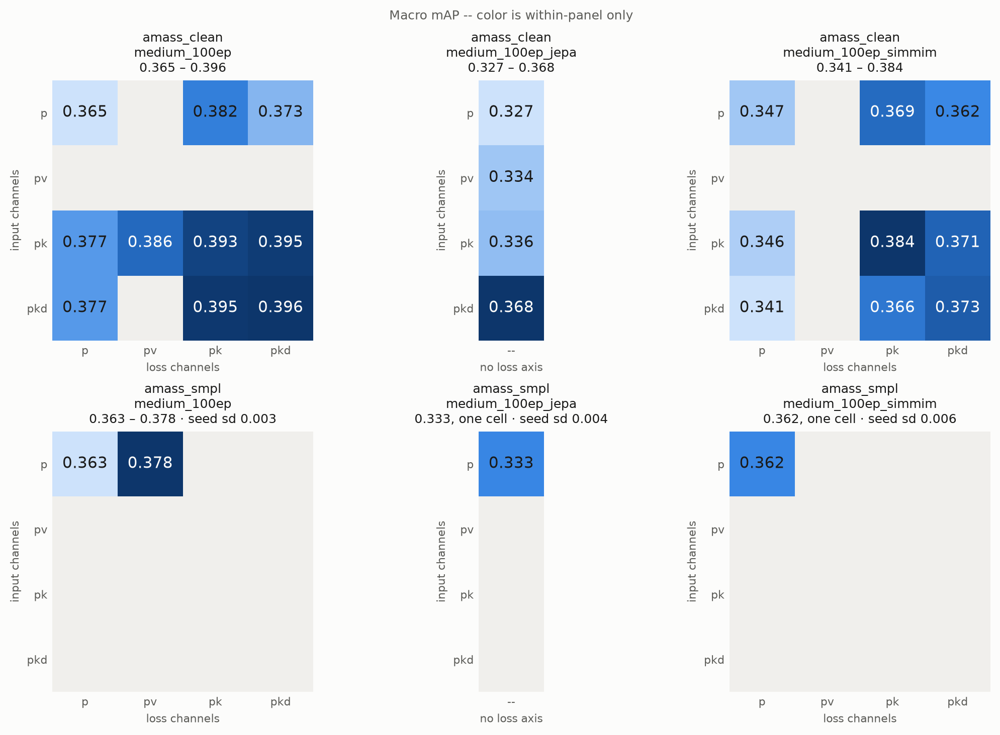
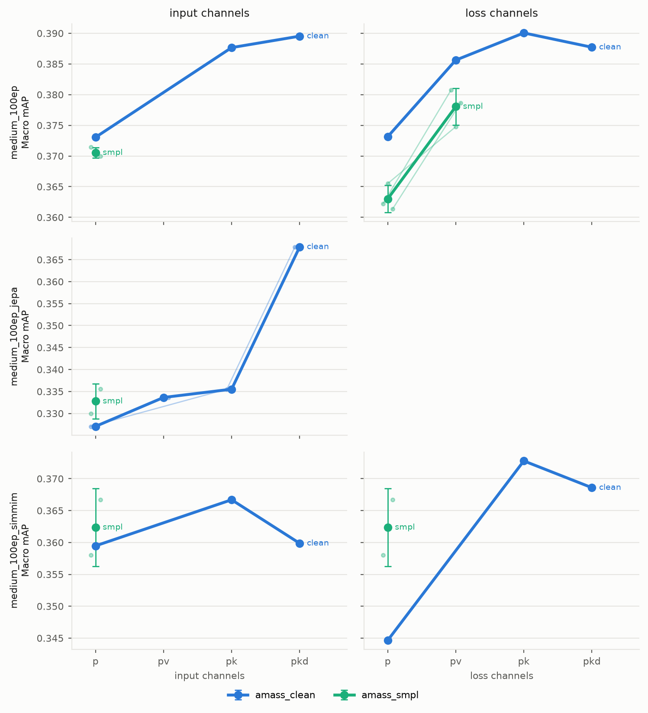
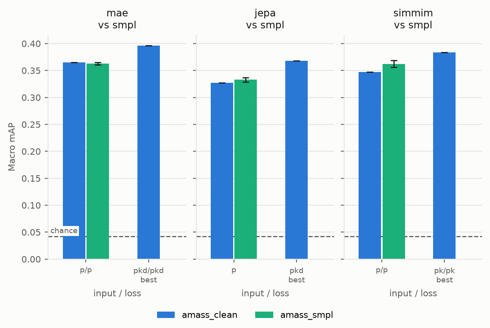
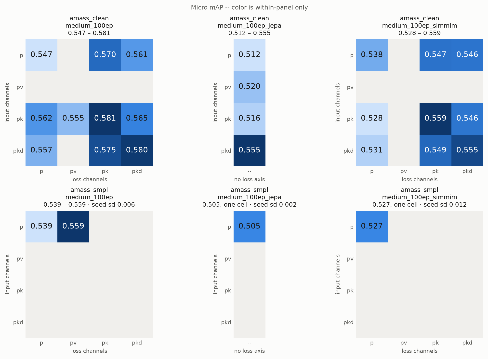
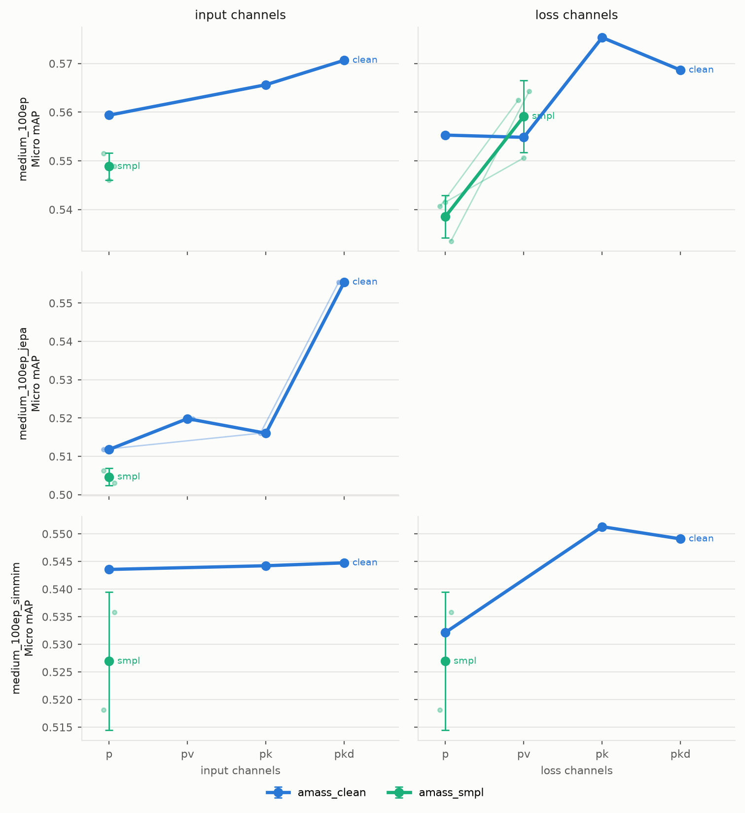
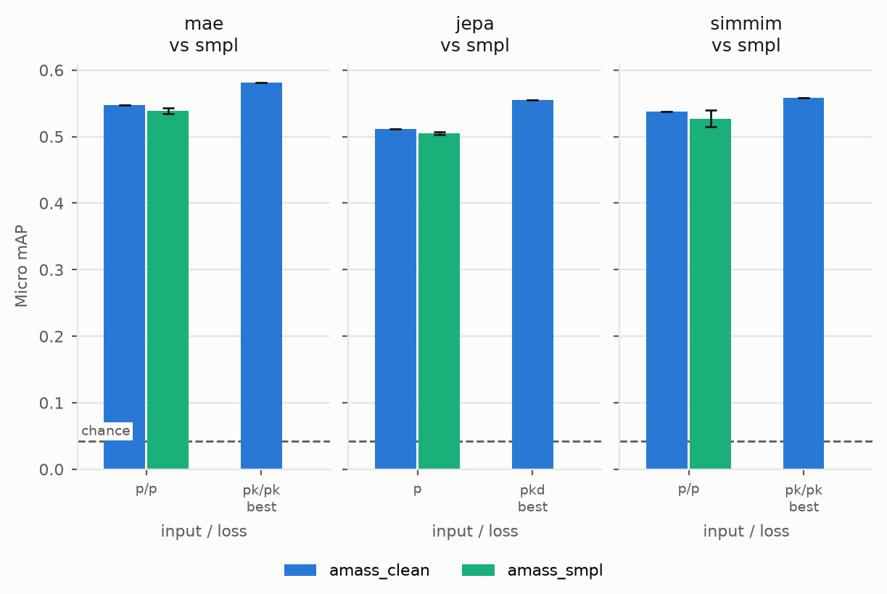

# babel_60_finetune

<!-- GENERATED by gen.py -- do not edit below this line -->

*33 cells across 2 corpora and 3 architectures. Regenerate with `gen.py`.*

*Held out of this report: `amass_motionx_clean`. The runs exist; `EXCLUDE_CORPORA` in `gen.py` is what drops them.*

*An architecture whose name carries an objective suffix (`_jepa`, `_simmim`) was pretrained with that objective; an unsuffixed one is the MAE baseline. JEPA has no reconstruction target, so its sections tabulate the input axis alone and it cannot speak to the loss-channel axis at all.*

*In the matrices, the percentage beside each cell is its relative difference from the best cell of that table: `(cell - best) / best`. It is within-table only, so it compares cells to each other and never across corpora or architectures.*

## Macro mAP

*Each matrix on its own color scale.*

*What each axis buys, per architecture.*

*Corpus against corpus, cell by cell.*

### `amass_clean` / medium_100ep (1 seed, no error bar)

| Input \ Loss | p | pv | pk | pkd |
| :--- | :---: | :---: | :---: | :---: |
| **p** | 0.3647 (-7.9%) | -- | 0.3818 (-3.6%) | 0.3726 (-5.9%) |
| **pv** | -- | -- | -- | -- |
| **pk** | 0.3773 (-4.7%) | 0.3856 (-2.6%) | 0.3931 (-0.7%) | 0.3946 (-0.4%) |
| **pkd** | 0.3774 (-4.7%) | -- | 0.3953 (-0.2%) | **0.3960** (+0.0%) |

### `amass_clean` / medium_100ep_jepa (1 seed, no error bar, input axis only)

| Input | Macro mAP |
| :--- | :---: |
| **p** | 0.3271 (-11.1%) |
| **pv** | 0.3336 (-9.3%) |
| **pk** | 0.3355 (-8.8%) |
| **pkd** | **0.3679** (+0.0%) |

### `amass_clean` / medium_100ep_simmim (1 seed, no error bar)

| Input \ Loss | p | pv | pk | pkd |
| :--- | :---: | :---: | :---: | :---: |
| **p** | 0.3475 (-9.4%) | -- | 0.3689 (-3.8%) | 0.3620 (-5.6%) |
| **pv** | -- | -- | -- | -- |
| **pk** | 0.3456 (-9.9%) | -- | **0.3835** (+0.0%) | 0.3710 (-3.3%) |
| **pkd** | 0.3409 (-11.1%) | -- | 0.3659 (-4.6%) | 0.3728 (-2.8%) |

### `amass_smpl` / medium_100ep (3 seeds)

| Input \ Loss | p | pv | pk | pkd |
| :--- | :---: | :---: | :---: | :---: |
| **p** | 0.3630 ±0.0022 (-4.0%) | **0.3780** ±0.0030 (+0.0%) | -- | -- |
| **pv** | -- | -- | -- | -- |
| **pk** | -- | -- | -- | -- |
| **pkd** | -- | -- | -- | -- |

### `amass_smpl` / medium_100ep_jepa (2 seeds, input axis only)

| Input | Macro mAP |
| :--- | :---: |
| **p** | **0.3328** ±0.0040 (+0.0%) |
| **pv** | -- |
| **pk** | -- |
| **pkd** | -- |

### `amass_smpl` / medium_100ep_simmim (2 seeds)

| Input \ Loss | p | pv | pk | pkd |
| :--- | :---: | :---: | :---: | :---: |
| **p** | **0.3624** ±0.0061 (+0.0%) | -- | -- | -- |
| **pv** | -- | -- | -- | -- |
| **pk** | -- | -- | -- | -- |
| **pkd** | -- | -- | -- | -- |

### Delta, `amass_smpl` − `amass_clean` (medium_100ep)

| Input \ Loss | p | pv | pk | pkd |
| :--- | :---: | :---: | :---: | :---: |
| **p** | -0.0017 (-0.6σ) | -- | -- | -- |
| **pv** | -- | -- | -- | -- |
| **pk** | -- | -- | -- | -- |
| **pkd** | -- | -- | -- | -- |

*Each cell reads `delta (z)`. The σ figure **is** z = delta / SE: how many standard errors of the difference the delta is, not how many seed sd's. σ = 0.0026 is the seed spread pooled over cells; with n = 1 vs 3 runs the difference of two means has SE = 0.0030, σ borrowed from `amass_smpl`, so 1σ here = 0.0030 Macro mAP. |z| > 2 is marginal (p < 0.05 for one pre-chosen cell); reading the whole 16-cell matrix and picking the largest needs |z| > 2.96 to keep the same 5% false-positive rate over the table.*

### Delta, `amass_smpl` − `amass_clean` (medium_100ep_jepa)

| Input \ Loss | -- |
| :--- | :---: |
| **p** | +0.0057 (+1.2σ) |
| **pv** | -- |
| **pk** | -- |
| **pkd** | -- |

*Each cell reads `delta (z)`. The σ figure **is** z = delta / SE: how many standard errors of the difference the delta is, not how many seed sd's. σ = 0.0040 is the seed spread pooled over cells; with n = 1 vs 2 runs the difference of two means has SE = 0.0049, σ borrowed from `amass_smpl`, so 1σ here = 0.0049 Macro mAP. |z| > 2 is marginal (p < 0.05 for one pre-chosen cell); reading the whole 4-cell matrix and picking the largest needs |z| > 2.50 to keep the same 5% false-positive rate over the table.*

### Delta, `amass_smpl` − `amass_clean` (medium_100ep_simmim)

| Input \ Loss | p | pv | pk | pkd |
| :--- | :---: | :---: | :---: | :---: |
| **p** | +0.0149 (+2.0σ) | -- | -- | -- |
| **pv** | -- | -- | -- | -- |
| **pk** | -- | -- | -- | -- |
| **pkd** | -- | -- | -- | -- |

*Each cell reads `delta (z)`. The σ figure **is** z = delta / SE: how many standard errors of the difference the delta is, not how many seed sd's. σ = 0.0061 is the seed spread pooled over cells; with n = 1 vs 2 runs the difference of two means has SE = 0.0075, σ borrowed from `amass_smpl`, so 1σ here = 0.0075 Macro mAP. |z| > 2 is marginal (p < 0.05 for one pre-chosen cell); reading the whole 16-cell matrix and picking the largest needs |z| > 2.96 to keep the same 5% false-positive rate over the table.*

## Micro mAP

*Each matrix on its own color scale.*

*What each axis buys, per architecture.*

*Corpus against corpus, cell by cell.*

### `amass_clean` / medium_100ep (1 seed, no error bar)

| Input \ Loss | p | pv | pk | pkd |
| :--- | :---: | :---: | :---: | :---: |
| **p** | 0.5474 (-5.8%) | -- | 0.5697 (-1.9%) | 0.5611 (-3.4%) |
| **pv** | -- | -- | -- | -- |
| **pk** | 0.5619 (-3.3%) | 0.5548 (-4.5%) | **0.5809** (+0.0%) | 0.5650 (-2.7%) |
| **pkd** | 0.5567 (-4.2%) | -- | 0.5754 (-0.9%) | 0.5799 (-0.2%) |

### `amass_clean` / medium_100ep_jepa (1 seed, no error bar, input axis only)

| Input | Micro mAP |
| :--- | :---: |
| **p** | 0.5118 (-7.9%) |
| **pv** | 0.5198 (-6.4%) |
| **pk** | 0.5160 (-7.1%) |
| **pkd** | **0.5555** (+0.0%) |

### `amass_clean` / medium_100ep_simmim (1 seed, no error bar)

| Input \ Loss | p | pv | pk | pkd |
| :--- | :---: | :---: | :---: | :---: |
| **p** | 0.5375 (-3.8%) | -- | 0.5467 (-2.1%) | 0.5464 (-2.2%) |
| **pv** | -- | -- | -- | -- |
| **pk** | 0.5280 (-5.5%) | -- | **0.5585** (+0.0%) | 0.5461 (-2.2%) |
| **pkd** | 0.5309 (-4.9%) | -- | 0.5486 (-1.8%) | 0.5547 (-0.7%) |

### `amass_smpl` / medium_100ep (3 seeds)

| Input \ Loss | p | pv | pk | pkd |
| :--- | :---: | :---: | :---: | :---: |
| **p** | 0.5386 ±0.0044 (-3.7%) | **0.5591** ±0.0074 (+0.0%) | -- | -- |
| **pv** | -- | -- | -- | -- |
| **pk** | -- | -- | -- | -- |
| **pkd** | -- | -- | -- | -- |

### `amass_smpl` / medium_100ep_jepa (2 seeds, input axis only)

| Input | Micro mAP |
| :--- | :---: |
| **p** | **0.5046** ±0.0023 (+0.0%) |
| **pv** | -- |
| **pk** | -- |
| **pkd** | -- |

### `amass_smpl` / medium_100ep_simmim (2 seeds)

| Input \ Loss | p | pv | pk | pkd |
| :--- | :---: | :---: | :---: | :---: |
| **p** | **0.5269** ±0.0125 (+0.0%) | -- | -- | -- |
| **pv** | -- | -- | -- | -- |
| **pk** | -- | -- | -- | -- |
| **pkd** | -- | -- | -- | -- |

### Delta, `amass_smpl` − `amass_clean` (medium_100ep)

| Input \ Loss | p | pv | pk | pkd |
| :--- | :---: | :---: | :---: | :---: |
| **p** | -0.0088 (-1.3σ) | -- | -- | -- |
| **pv** | -- | -- | -- | -- |
| **pk** | -- | -- | -- | -- |
| **pkd** | -- | -- | -- | -- |

*Each cell reads `delta (z)`. The σ figure **is** z = delta / SE: how many standard errors of the difference the delta is, not how many seed sd's. σ = 0.0059 is the seed spread pooled over cells; with n = 1 vs 3 runs the difference of two means has SE = 0.0068, σ borrowed from `amass_smpl`, so 1σ here = 0.0068 Micro mAP. |z| > 2 is marginal (p < 0.05 for one pre-chosen cell); reading the whole 16-cell matrix and picking the largest needs |z| > 2.96 to keep the same 5% false-positive rate over the table.*

### Delta, `amass_smpl` − `amass_clean` (medium_100ep_jepa)

| Input \ Loss | -- |
| :--- | :---: |
| **p** | -0.0072 (-2.6σ) |
| **pv** | -- |
| **pk** | -- |
| **pkd** | -- |

*Each cell reads `delta (z)`. The σ figure **is** z = delta / SE: how many standard errors of the difference the delta is, not how many seed sd's. σ = 0.0023 is the seed spread pooled over cells; with n = 1 vs 2 runs the difference of two means has SE = 0.0028, σ borrowed from `amass_smpl`, so 1σ here = 0.0028 Micro mAP. |z| > 2 is marginal (p < 0.05 for one pre-chosen cell); reading the whole 4-cell matrix and picking the largest needs |z| > 2.50 to keep the same 5% false-positive rate over the table.*

### Delta, `amass_smpl` − `amass_clean` (medium_100ep_simmim)

| Input \ Loss | p | pv | pk | pkd |
| :--- | :---: | :---: | :---: | :---: |
| **p** | -0.0106 (-0.7σ) | -- | -- | -- |
| **pv** | -- | -- | -- | -- |
| **pk** | -- | -- | -- | -- |
| **pkd** | -- | -- | -- | -- |

*Each cell reads `delta (z)`. The σ figure **is** z = delta / SE: how many standard errors of the difference the delta is, not how many seed sd's. σ = 0.0125 is the seed spread pooled over cells; with n = 1 vs 2 runs the difference of two means has SE = 0.0153, σ borrowed from `amass_smpl`, so 1σ here = 0.0153 Micro mAP. |z| > 2 is marginal (p < 0.05 for one pre-chosen cell); reading the whole 16-cell matrix and picking the largest needs |z| > 2.96 to keep the same 5% false-positive rate over the table.*

## Can the cells be ranked?

| corpus | arch | cells | range | seed σ | range / σ | noise bar | verdict |
| :--- | :--- | ---: | ---: | ---: | ---: | ---: | :--- |
| amass_smpl | medium_100ep | 2 | 0.0150 | 0.0026 | 5.75 | 1.13 | **above noise** |

*Range across the cell means over the seed sd pooled across cells. The bar is E[range] of that many draws from pure noise -- nine identical cells still spread, so the comparison is against ~3σ, not 0. Above the bar the matrix carries structure worth ranking; below it, the best cell is a selection effect.*

## Marginal level of each axis

| corpus | arch | axis | `p` | `pv` | `pk` | `pkd` |
| :--- | :--- | :--- | ---: | ---: | ---: | ---: |
| amass_smpl | medium_100ep | input | 0.3705 | -- | -- | -- |
| amass_smpl | medium_100ep | loss | 0.3630 | 0.3780 | -- | -- |
| amass_smpl | medium_100ep_jepa | input | 0.3328 | -- | -- | -- |
| amass_smpl | medium_100ep_simmim | input | 0.3624 | -- | -- | -- |
| amass_smpl | medium_100ep_simmim | loss | 0.3624 | -- | -- | -- |

*Each value averages over the other axis. Levels only -- whether a difference between them is real is the next table.*

## Where along the ladder the gain appears

| corpus | arch | axis | `p`→`pv` | `pv`→`pk` | `pk`→`pkd` | total `p`→`pkd` |
| :--- | :--- | :--- | ---: | ---: | ---: | ---: |
| amass_smpl | medium_100ep | input | -- | -- | -- | -- |
| amass_smpl | medium_100ep | loss | +0.0150 (0.035) | -- | -- | -- |
| amass_smpl | medium_100ep_jepa | input | -- | -- | -- | -- |
| amass_smpl | medium_100ep_simmim | input | -- | -- | -- | -- |
| amass_smpl | medium_100ep_simmim | loss | -- | -- | -- | -- |

*Paired step to the next rung, signed so positive means widening helped. Cells share a seed and seed spread is several times these effects, so each step is paired on replicate (n = 3) rather than compared as independent means. Parenthesis is the two-sided paired p; bold is significant at 0.05 Bonferroni-corrected over the 20 steps and totals shown. At three replicates a p rests on two degrees of freedom -- read direction and magnitude before decisions.*

## Best cell per corpus

| corpus | arch | cell | runs | macro_map | micro_map |
| :--- | :--- | :--- | ---: | ---: | ---: |
| amass_clean | medium_100ep | `in_pkd__loss_pkd` | 1 | 0.3960 | 0.5799 |
| amass_clean | medium_100ep_jepa | `in_pkd` | 1 | 0.3679 | 0.5555 |
| amass_clean | medium_100ep_simmim | `in_pk__loss_pk` | 1 | 0.3835 | 0.5585 |
| amass_smpl | medium_100ep | `in_p__loss_pv` | 3 | 0.3780 | 0.5591 |
| amass_smpl | medium_100ep_jepa | `in_p` | 2 | 0.3328 | 0.5046 |
| amass_smpl | medium_100ep_simmim | `in_p__loss_p` | 2 | 0.3624 | 0.5269 |

## Replicate spread

| corpus | arch | runs/cell | cells | sd macro_map | sd micro_map |
| :--- | :--- | ---: | ---: | ---: | ---: |
| amass_smpl | medium_100ep | 3 | 2 | 0.0026 | 0.0059 |
| amass_smpl | medium_100ep_jepa | 2 | 1 | 0.0040 | 0.0023 |
| amass_smpl | medium_100ep_simmim | 2 | 1 | 0.0061 | 0.0125 |

## Reference points

| baseline | Macro mAP | Micro mAP | vs best cell | protocol |
| :--- | ---: | ---: | ---: | :--- |
| chance | 0.0421 | 0.0421 | 9.41x | exact, no model |

*Best cell: 0.3960 macro mAP, taken over every architecture present, so it is the best result on the board rather than the best MAE one.*

- **chance** -- Average precision of a random ranking equals the class positive rate, so this is the mean per-class positive rate over the BABEL-60 validation windows. Computed from the annotations, so it is protocol-independent and applies to a fine-tune exactly as it does to a probe.

The probe report's other two baselines are deliberately absent. `moments` and `random encoder` are both frozen-readout numbers; a fine-tune trains the backbone, so neither is the same measurement and a dashed line would invite the comparison anyway.

## Provenance

| corpus | arch | replicates | normalization |
| :--- | :--- | :--- | :--- |
| amass_clean | medium_100ep | seed1 | `pretrain_v1_stats_train_clean.pt` |
| amass_clean | medium_100ep_jepa | seed1, seed42 | `pretrain_v1_stats_train_clean.pt` |
| amass_clean | medium_100ep_simmim | seed1 | `pretrain_v1_stats_train_clean.pt` |
| amass_smpl | medium_100ep | seed1, seed2, seed42 | `pretrain_paired_v1_train_clean.pt` |
| amass_smpl | medium_100ep_jepa | seed1, seed42 | `pretrain_paired_v1_train_clean.pt` |
| amass_smpl | medium_100ep_simmim | seed1, seed42 | `pretrain_paired_v1_train_clean.pt` |

<!-- /GENERATED -->
